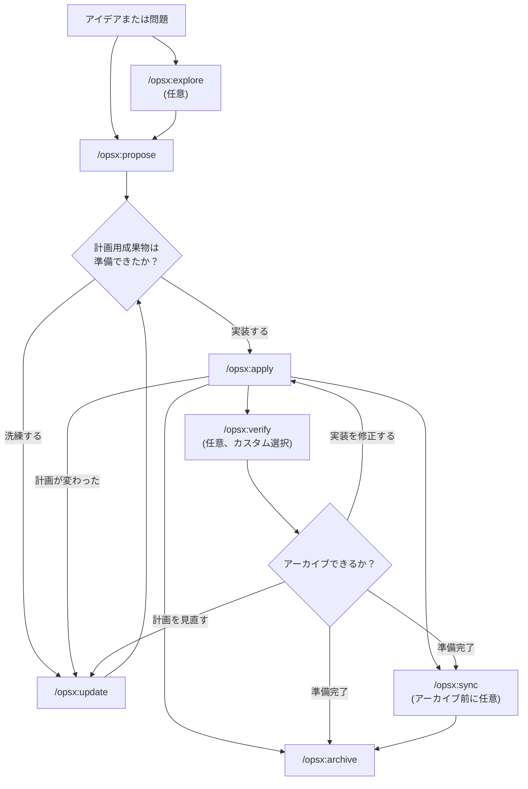
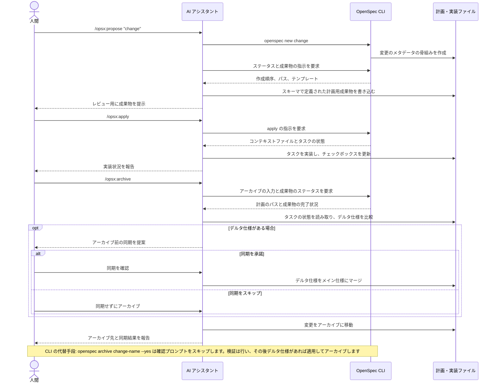

<a id="workflows"></a>
# ワークフロー

このガイドでは、OpenSpec の一般的なワークフローのパターンと、それぞれをいつ使うべきかを説明します。基本的なセットアップについては [はじめに](getting-started.md) を、コマンドのリファレンスについては [コマンド](commands.md) を参照してください。

<a id="philosophy-actions-not-phases"></a>
## 思想: フェーズではなく、アクション

従来のワークフローでは、計画、実装、完了という順にフェーズを通過することが求められます。しかし、実際の作業はきれいな箱には収まりません。

OPSX は異なるアプローチを取ります。

```text
従来型（フェーズ固定）:

  PLANNING ────────► IMPLEMENTING ────────► DONE
      │                    │
      │   「戻れない」       │
      └────────────────────┘

OPSX（流動的なアクション）:

  proposal ──► specs ──► design ──► tasks ──► implement
```

**主な原則:**

- **フェーズではなくアクション** - コマンドは実行できることであり、閉じ込められる段階ではありません
- **依存関係は手段である** - 何が可能かを示すものであり、次に何が必要かを示すものではありません

> **カスタマイズ:** OPSX のワークフローは、成果物の順序を定義するスキーマによって駆動されます。カスタムスキーマの作成については、[カスタマイズ](customization.md) を参照してください。

<a id="workflow-at-a-glance"></a>
## ワークフローの全体像

デフォルトのワークフローは流動的です。探索と検証は任意であり、実装によって新たな発見があれば、
いつでも計画用成果物を更新できます。



ワークフローを進めるのは AI アシスタントであり、CLI は決定論的な
骨組みの作成、ステータス、成果物の指示を提供します。



<a id="two-modes"></a>
## 2つのモード

<a id="default-quick-path-core-profile"></a>
### デフォルトのクイックパス（`core` プロファイル）

新規インストールのデフォルトは `core` で、次を提供します。
- `/opsx:explore`
- `/opsx:propose`
- `/opsx:apply`
- `/opsx:update`
- `/opsx:sync`
- `/opsx:archive`

典型的な流れ:

```text
/opsx:explore ──► /opsx:propose ──► /opsx:apply ──► /opsx:sync ──► /opsx:archive
  (任意)
```

<a id="start-by-exploring-the-habit-worth-forming"></a>
#### 探索から始める（身につけたい習慣）

`/opsx:explore` はデフォルトのプロファイルの一部であり、上級者向けの追加機能ではありません。問題はあるがまだ計画がない場合に使うべき一手であり、AI アシスタントと作業するなら、それはほとんどの場面です。

```text
You: /opsx:explore

AI:  何を探索しますか？

You: 検索結果が古い気がします。キャッシュなのか、インデックスなのか、
     クエリ自体なのかがわかりません。

AI:  調べてみます... [検索サービスとキャッシュ層を読む]
     原因はインデックスです。毎晩しか再構築されないため、編集内容は
     翌日まで反映されません。選択肢は2つあります。書き込み時に再構築する
     （シンプルだが負荷が増える）か、短い TTL のキャッシュ無効化
     （可動部分が増えるが負荷は減る）。書き込み量が少ないことを考えると、
     書き込み時の再構築のほうがすっきりした解決策です。スコープを整理しましょうか？

You: はい。

You: /opsx:propose rebuild-search-index-on-write
```

探索はコードを書くことはなく、あなたが頼むか、提案に対して承諾しない限り何も書きません。曖昧な不安を正確な変更へと変える、無料でリスクのない会話であり、そのため続く提案が的確になります。何がしたいかを正確にわかっている？ それなら探索は飛ばして、直接 `/opsx:propose` に進んでください。完全なガイド: [まず探索する](explore.md)。

<a id="expandedfull-workflow-custom-selection"></a>
### 拡張/フルワークフロー（カスタム選択）

骨組みの作成と実装を明示的に行うコマンド（`/opsx:new`、`/opsx:continue`、`/opsx:ff`、`/opsx:verify`、`/opsx:bulk-archive`、`/opsx:onboard`）が必要な場合は、次のコマンドで有効にします。

```bash
openspec config profile
openspec update
```

<a id="workflow-patterns-expanded-mode"></a>
## ワークフローのパターン（拡張モード）

<a id="quick-feature"></a>
### クイック機能開発

何を作りたいかがわかっていて、実行するだけでよい場合:

```text
/opsx:new ──► /opsx:ff ──► /opsx:apply ──► /opsx:verify ──► /opsx:archive
```

**会話の例:**

```text
You: /opsx:new add-logout-button

AI:  openspec/changes/add-logout-button/ を作成しました
     作成可能: proposal

You: /opsx:ff

AI:  すべての計画用成果物を作成しています...
     ✓ proposal.md
     ✓ specs/
     ✓ design.md
     ✓ tasks.md
     実装の準備ができました！

You: /opsx:apply

AI:  タスクを進めています...
     ✓ ヘッダーにログアウトボタンを追加
     ✓ セッションのクリアを実装
     ✓ 確認ダイアログを追加
     すべてのタスクが完了しました！

You: /opsx:archive

AI:  ✓ 仕様をマージしました
     ✓ 変更をアーカイブしました
```

**最適な用途:** 小〜中規模の機能、バグ修正、わかりやすい変更。

<a id="exploratory"></a>
### 探索型

要件が不明確な場合や、先に調査が必要な場合:

```text
/opsx:explore ──► /opsx:new ──► /opsx:continue ──► ... ──► /opsx:apply
```

**会話の例:**

```text
You: /opsx:explore

AI:  何を探索しますか？

You: ページの読み込み性能を改善したいのですが、ボトルネックがどこに
     あるのかわかりません。

AI:  調査をお手伝いします...
     [バンドルサイズを分析し、遅いクエリを特定し、コンポーネントの
     レンダリングパターンをレビューする]

     主なボトルネックが3つ見つかりました。
     1. 最適化されていない大きな画像
     2. ProductList での同期的なデータ取得
     3. コンテキストの変更による再レンダリング

     どれから対処しますか？

You: データ取得の問題に取り組みましょう。

You: /opsx:new optimize-product-list-fetching

AI:  変更を作成しました。作成可能: proposal

You: /opsx:continue

AI:  探索の内容に基づいて提案を作成しています...
     [調査で得られた知見を取り入れた提案を書く]

     作成可能: specs, design
     次はどちらにしますか？

You: /opsx:continue

AI:  仕様を作成しています...
```

**最適な用途:** パフォーマンスの最適化、デバッグ、アーキテクチャ上の判断、不明確な要件。

<a id="parallel-changes"></a>
### 並行する変更

複数の変更を同時に進める場合:

```text
Change A: /opsx:new ──► /opsx:ff ──► /opsx:apply (進行中)
                                         │
                                    コンテキスト切り替え
                                         │
Change B: /opsx:new ──► /opsx:ff ──────► /opsx:apply
```

**会話の例:**

```text
You: add-dark-mode を進めていましたが、バグ修正に割り込まれました

You: /opsx:new fix-login-redirect

AI:  openspec/changes/fix-login-redirect/ を作成しました

You: /opsx:ff

AI:  ✓ 計画用成果物を作成しました

You: /opsx:apply

AI:  fix-login-redirect に取り組んでいます...
     [修正を実装する]
     すべてのタスクが完了しました！

You: /opsx:archive

AI:  ✓ fix-login-redirect をアーカイブしました

You: ダークモードに戻りましょう

You: /opsx:apply add-dark-mode

AI:  add-dark-mode を再開します...
     タスク 2.3: Header の更新 から続けます...
```

**最適な用途:** 並行する作業の流れ、緊急の割り込み、チームでの共同作業。

完了した変更が複数ある場合は、`/opsx:bulk-archive` を使います。

```text
You: /opsx:bulk-archive

AI:  完了した変更が3件見つかりました。
     - add-dark-mode (全タスク完了)
     - fix-login-redirect (全タスク完了)
     - update-footer (全タスク完了)

     仕様の競合を確認しています...
     ⚠ add-dark-mode と update-footer は、どちらも specs/ui/ に触れています

     コードベースを調べて解決します...
     どちらの変更も実装済みです。時系列順に適用します。

     3件の変更をすべてアーカイブしますか？

You: はい

AI:  ✓ add-dark-mode をアーカイブしました
     ✓ fix-login-redirect をアーカイブしました
     ✓ update-footer をアーカイブしました
     仕様のマージ順: add-dark-mode → update-footer
```

一括アーカイブは、複数の変更が同じ仕様に触れていることを検出し、実際に実装されている内容を確認して競合を解決します。

<a id="completing-a-change"></a>
### 変更を完了する

推奨される完了までの流れ:

```text
/opsx:apply ──► /opsx:verify ──► /opsx:archive
                    │                 │
              実装を検証          必要に応じて
                                  同期を促す
```

<a id="verify-check-your-work"></a>
#### 検証: 作業内容を確認する

`/opsx:verify` は、成果物に照らして実装を、3つの観点で検証します。

```text
You: /opsx:verify

AI:  add-auth を検証しています...

     COMPLETENESS
     ✓ tasks.md の 12 個のタスクがすべてチェック済み
     ✓ specs のすべての要件に対応するコードがある
     ⚠ シナリオ "Session timeout after inactivity" がテストされていない

     CORRECTNESS
     ✓ 実装が仕様の意図に一致している
     ✓ シナリオのエッジケースが処理されている
     ✓ エラー状態が仕様の定義に一致している

     COHERENCE
     ✓ 設計上の判断がコード構造に反映されている
     ✓ 命名規則が design.md と一貫している
     ⚠ 設計では "event-driven" とあるが、実装はポーリングを使っている

     SUMMARY
     ─────────────────────────────
     Critical issues: 0
     Warnings: 2
     Ready to archive: Yes (with warnings)

     Recommendations:
     1. セッションタイムアウトのシナリオのテストを追加する
     2. 設計どおりイベント駆動にリファクタリングするか、design.md を更新することを検討する
```

**verify がチェックする内容:**

| 観点 | 検証する内容 |
|-----------|------------------|
| 完全性 | すべてのタスクが完了し、すべての要件が実装され、シナリオがカバーされている |
| 正確性 | 実装が仕様の意図に一致し、エッジケースが処理されている |
| 一貫性 | 設計上の判断がコードに反映され、パターンが一貫している |

verify はアーカイブをブロックしませんが、先に対処したほうがよい問題を明らかにします。

<a id="archive-finalize-the-change"></a>
#### アーカイブ: 変更を確定する

`/opsx:archive` は変更を完了し、アーカイブに移動します。

```text
You: /opsx:archive

AI:  add-auth をアーカイブしています...

     成果物のステータス:
     ✓ proposal.md が存在する
     ✓ specs/ が存在する
     ✓ design.md が存在する
     ✓ tasks.md が存在する (12/12 タスク完了)

     デルタ仕様: まだメインに同期されていません
     → 今すぐ同期しますか？

You: はい

AI:  ✓ 仕様を openspec/specs/auth/spec.md に同期しました
     ✓ openspec/changes/archive/2025-01-24-add-auth/ に移動しました

     変更が正常にアーカイブされました。
```

仕様が同期されていない場合、アーカイブは確認を求めます。未完了のタスクがあってもブロックはしませんが、警告します。

<a id="when-to-use-what"></a>
## 何を使うべきか

<a id="opsxff-vs-opsxcontinue"></a>
### `/opsx:ff` と `/opsx:continue`

| 状況 | 使うもの |
|-----------|-----|
| 要件が明確で、実装する準備ができている | `/opsx:ff` |
| 探索中で、各ステップをレビューしたい | `/opsx:continue` |
| 仕様に進む前に提案を反復したい | `/opsx:continue` |
| 時間的な制約があり、素早く進める必要がある | `/opsx:ff` |
| 複雑な変更で、制御したい | `/opsx:continue` |

**目安:** 最初から全体のスコープを説明できるなら `/opsx:ff` を、進めながら考えるなら `/opsx:continue` を使います。

<a id="when-to-update-vs-start-fresh"></a>
### 更新するか、やり直すか

よくある質問: 既存の変更を更新してよいのはいつで、新しく始めるべきなのはいつか？

**既存の変更を更新するとき:**

- 意図は同じで、実行方法を洗練させる
- スコープの縮小（まず MVP、残りは後で）
- 学びに基づく修正（コードベースが想定と違っていた）
- 実装中の発見に基づく設計の調整

**新しい変更を始めるとき:**

- 意図が根本的に変わった
- スコープが膨らんで、まったく別の作業になった
- 元の変更を単独で「完了」にできる
- パッチを当てると、わかりやすくなるどころか混乱する

```text
                     ┌─────────────────────────────────────┐
                     │         これは同じ作業か？            │
                     └──────────────┬──────────────────────┘
                                    │
                 ┌──────────────────┼──────────────────┐
                 │                  │                  │
                 ▼                  ▼                  ▼
          同じ意図か？        50%以上重複しているか？   これらの変更なしで
          同じ問題か？        同じスコープか？         元の変更を「完了」
                 │                  │               にできるか？
                 │                  │                  │
       ┌────────┴────────┐  ┌──────┴──────┐   ┌───────┴───────┐
       │                 │  │             │   │               │
      YES               NO YES           NO  NO              YES
       │                 │  │             │   │               │
       ▼                 ▼  ▼             ▼   ▼               ▼
    UPDATE            NEW  UPDATE       NEW  UPDATE          NEW
```

**例: 「ダークモードを追加する」**

- 「カスタムテーマにも対応する必要が出てきた」→ 新しい変更（スコープが膨らんだ）
- 「システム設定の検出が思ったより難しい」→ 更新（同じ意図）
- 「まず切り替え機能をリリースして、設定は後で追加しよう」→ 更新してからアーカイブし、新しい変更を作る

<a id="best-practices"></a>
## ベストプラクティス

<a id="keep-changes-focused"></a>
### 変更は焦点を絞る

1つの変更に、論理的な作業の単位は1つです。「機能 X を追加して、ついでに Y もリファクタリングする」ということなら、2つの別々の変更を検討してください。

**重要な理由:**
- レビューや理解がしやすい
- アーカイブの履歴がすっきりする
- 独立してリリースできる
- 必要な場合のロールバックが簡単になる

<a id="use-opsxexplore-for-unclear-requirements"></a>
### 不明確な要件には `/opsx:explore` を使う

変更を決める前に、問題の領域を探索します。

```text
You: /opsx:explore

AI:  何を探索しますか？

You: API のレート制限はどう扱うべきでしょうか？

AI:  現在の構成と選択肢を調べてみます...
     [コードベースを調査し、パターンを検討する]

     取りうるアプローチは3つあります。
     1. ミドルウェアベース（シンプル、エンドポイントごと）
     2. Redis ベース（スケーラブル、共有状態）
     3. ユーザーごとのトークンバケット（公平、複雑）

     現在のスタックでは #1 か #2 が向いています。規模はどれくらいですか？
```

探索は、コードが書かれる前に考えを明確にします。

<a id="verify-before-archiving"></a>
### アーカイブ前に検証する

`/opsx:verify` を使って、実装が成果物と一致しているかを確認します。

```text
You: /opsx:verify

AI:  add-dark-mode を検証しています...

     ✓ tasks.md のすべてのタスクがチェック済み
     ✓ specs の要件に対応するコードがある
     ✓ 設計上の判断が実装に反映されている

     アーカイブの準備ができました！
```

変更を完了する前に、不一致を見つけられます。

<a id="name-changes-clearly"></a>
### 変更に明確な名前を付ける

良い名前は、`openspec list` を役立つものにします。

```text
良い例:                          避けたい例:
add-dark-mode                  feature-1
fix-login-redirect             update
optimize-product-query         changes
implement-2fa                  wip
```

<a id="command-quick-reference"></a>
## コマンド早見表

コマンドの詳細とオプションについては、[コマンド](commands.md) を参照してください。

| コマンド | 目的 | 使うタイミング |
|---------|---------|-------------|
| `/opsx:propose` | 変更と計画用成果物を作成する | 高速なデフォルトパス（`core` プロファイル） |
| `/opsx:explore` | AI とアイデアを考え抜く | 迷ったらここから: 不明確な要件、調査、選択肢の比較 |
| `/opsx:new` | 変更の骨組みを開始する | 拡張モード、成果物を明示的に制御したいとき |
| `/opsx:continue` | 次の成果物を作成する | 拡張モード、成果物を段階的に作成するとき |
| `/opsx:ff` | すべての計画用成果物を作成する | 拡張モード、スコープが明確なとき |
| `/opsx:apply` | タスクを実装する | コードを書く準備ができたとき |
| `/opsx:verify` | 実装を検証する | 拡張モード、アーカイブの前 |
| `/opsx:sync` | デルタ仕様をマージする | 拡張モード、任意 |
| `/opsx:archive` | 変更を完了する | すべての作業が終わったとき |
| `/opsx:bulk-archive` | 複数の変更をアーカイブする | 拡張モード、並行作業のとき |

<a id="next-steps"></a>
## 次のステップ

- [良い仕様の書き方](writing-specs.md) - 優れた要件とシナリオの姿と、変更を適切なサイズにする方法
- [変更のレビュー](reviewing-changes.md) - コードを書く前に、下書きされた計画を確認する2分間のチェック
- [チームでの OpenSpec](team-workflow.md) - 変更をブランチやプルリクエストにどう組み込むか
- [コマンド](commands.md) - オプション付きの完全なコマンドリファレンス
- [概念](concepts.md) - 仕様、成果物、スキーマの詳細解説
- [カスタマイズ](customization.md) - カスタムワークフローを作成する
